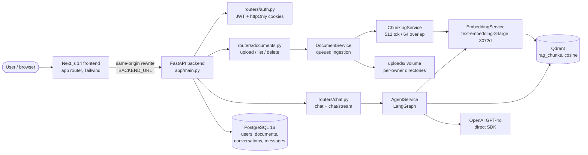
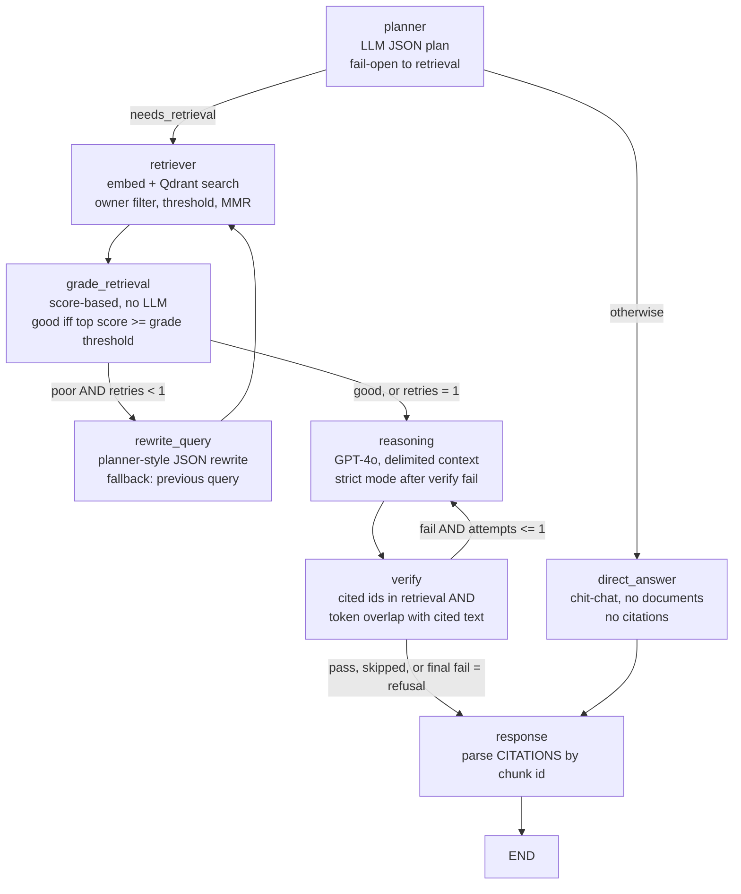

# Architecture

## System diagram



Layering is strict: routers -> services -> repositories -> database /
vector store. Routers contain no retrieval or embedding logic; services
contain no HTTP logic. The one deliberate exception is documented in
`docs/phase-a-report.md`: `rag_service.py` now only provides the
citation parser (`parse_citations`) used by the agent's response node.

## LangGraph

Source of truth: `backend/app/services/agent_service.py` and
`docs/graph.mmd` (rendered below). Both chat endpoints run this graph;
there is no second RAG path.



State fields (`AgentState`): `question, owner_id, document_id, history,
retrieval_query, chunks, answer, citations, needs_retrieval`, plus
Phase C fields for errors, retries, and scores (see the service for
the exact current fields -- state is the graph's contract, so read it
before changing a node). There are no tools in v1.0.0: the
document-scoped tool idea from Phase C was only added if it added real
value, and it did not meet that bar, so the graph stays tool-free.
Claims about "agentic" behaviour should be limited to: conditional
routing, one bounded rewrite/retry, and one bounded verify/regenerate.

## Request flows

### Upload (queued, Phase E)

```
POST /api/v1/documents/upload (rate-limited, owner from auth)
  -> DocumentService.ingest: magic-byte validation, size streaming
     (50 MB cap), UUID filename under uploads/<owner_id>/
  -> row created with status queued, progress 0
  -> worker (scripts/run_ingestion_worker.py): extract (threadpool)
     -> sentence/paragraph-aware chunking (offsets, page, section, hash)
     -> embed_batch (<=100 inputs/call, tenacity backoff, 30s timeout)
     -> upsert_chunks (owner_id payload, chunk-level dedupe)
     -> status ready (progress 100) or error (safe message, file +
        vectors cleaned up; embedding failure -> 502 path, never a
        fallback vector)
```

### Chat (both endpoints, one graph)

```
POST /api/v1/chat  |  POST /api/v1/chat/stream
  -> conversation resolved/created, owner-checked
  -> AgentService.run / run_stream (same graph, same prompt,
     planner history = last 4 messages, reasoning/direct = last 10,
     context budget 6000 tokens, history budget 2000 tokens,
     chat output cap 1000 tokens)
  -> stream yields SSE: status, token, citations, done, error
  -> assistant message persisted even on client disconnect
     (generator finally block); non-stream maps agent failures to
     a safe 502 without leaking internals
```

### Citations

Qdrant payload (`text, document_id, document_name, chunk_index, page,
section, owner_id`, plus score at search time) -> retriever chunks ->
reasoning numbers context by chunk id -> model cites `[chunk-id]` ->
`response_node` parses with `rag_service.parse_citations`, which
validates every cited id was actually retrieved, and drops anything
else. Only validated, cited chunks are shown, with page/section and
snippet, in the frontend source panel. The stream path used to show
all retrieved chunks; that was a Phase A bug and is gone.

## Endpoints

Generated reference: `docs/openapi.json` (14 paths). Liveness vs
readiness is a real distinction here: `/health` only proves the
process is up; `/ready` requires Postgres and Qdrant to answer within
5s each and returns 503 otherwise. `/metrics` is in-process
Prometheus text (counters + latency histograms, lost on restart).

## Configuration reference (defaults)

See `backend/app/core/config.py` -- it is the single source of truth,
and it validates: dimensions 1..3072, thresholds/MMR in 0..1,
`RETRIEVAL_TOP_K <= RETRIEVAL_FETCH_K`, `CHUNK_OVERLAP < CHUNK_SIZE`,
positive rate/limit/quota values, and CORS rules (production rejects
`*`). Key defaults: chunk 512/64, top-k 5, fetch-k 20, similarity
threshold 0.30, grade threshold 0.50, MMR λ 0.7, context 6000 /
history 2000 / chat output 1000 tokens, upload 50 MB, JWT 60 minutes,
auth/upload/chat rate limits 10/10/30 per minute, lockout 5 failures /
15 minutes, daily quota 200 chats / 200k estimated tokens, circuit
breaker 3 failures / 60s cooldown, ingestion max 2 attempts.

Thresholds (0.30, 0.50, λ 0.7) are unmeasured starting defaults, not
tuned optima -- Phase D explicitly refused to retune them on fake
embeddings. The live eval must measure them before any tuning claim.
